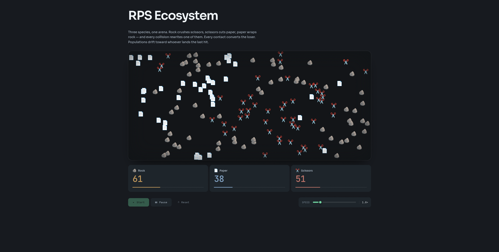

# RPS Ecosystem Simulator

A rock-paper-scissors ecosystem simulator built with SvelteKit. 150 entities move inside a closed arena, and every collision between two different species converts the loser to the winner's species, so the population stays at 150 while the cycle rotates.

Built with Svelte 5 (runes), SvelteKit, TypeScript and Vite. No simulation, animation or charting libraries — the whole simulation runs on a single 2D canvas.



## Run it locally

```sh
npm install
npm run dev
```

Then open http://localhost:5173.

## Stack

- [Svelte 5](https://svelte.dev) with runes (`$state`) for reactive UI
- [SvelteKit](https://svelte.dev/docs/kit) for routing and SSR
- TypeScript

## License

[MIT](LICENSE)
